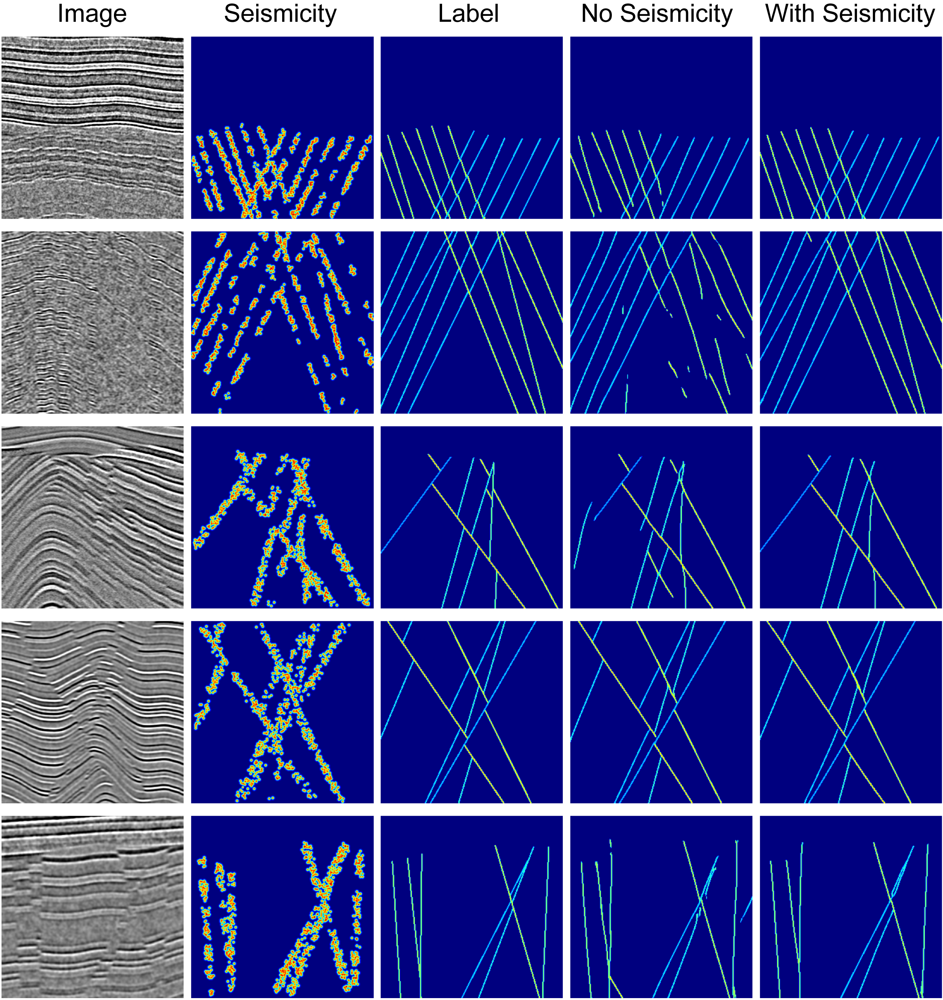

# Description
**SCF: Seismicity-Constrained Fault Detection and Characterization**



Fault detection is one of the central challenges in subsurface imaging and characterization. We develop a seismicity-constrained fault detection and characterization based on a multitask machine learning model to leverage both seismic migration image and seismicity location information. The repository contains codes associated with the ML models and the codes for generating training data.

The work was supported by Los Alamos National Laboratory (LANL) Laboratory Directed Research and Development (LDRD) project 20240322ER. LANL is operated by Triad National Security, LLC, for the National Nuclear Security Administration (NNSA) of the U.S. Department of Energy (DOE) under Contract No. 89233218CNA000001. The research used high-performance computing resources provided by LANL's Institutional Computing program.

The work is under LANL open source approval reference O4809.

# Requirement
`SCF` requires PyTorch, Lightning, TensorBoard, NumPy, SciPy, matplotlib, and tqdm. The data generation requires the Python interface of [RGM](https://github.com/lanl/rgm), which depends on [FLIT](https://github.com/lanl/flit), and mpi4py to run on several MPI processes. Import `rgm` before `torch` in your own scripts: with `torch` imported first, RGM returns images of NaN values.

# Use
The directories `2d` and `3d` contain the data generation (`generate_data.py`), a training script, and a validation script:

```
cd 2d        # or 3d
bash run_train.sh
bash run_valid.sh
```

`run_train.sh` generates the training and validation data on several MPI processes and trains the network on one or several GPUs; the variables at the top of the script set the numbers of samples, processes, and GPUs. `run_valid.sh` compares the three input modes: it writes the precision, recall, F1 score, and dip (and strike) errors of every mode on the validation set (`metrics_validation.txt` and `.png`), figures of validation samples, the agreement of block-wise and whole-image inference, and the faults of a field example from every mode (the Opunake image in 2D and the F3 volume in 3D). [doc/README.md](doc/README.md) describes the data format, the options, and inference on large images and volumes.

The `test` directories in `2d` and `3d` contain field data examples.

To reproduce the results in the published paper, please use release v1.0.0. 

# License
&copy; 2024-2026. Triad National Security, LLC. All rights reserved.

This program is Open-Source under the BSD-3 License.

Redistribution and use in source and binary forms, with or without modification, are permitted provided that the following conditions are met:

- Redistributions of source code must retain the above copyright notice, this list of conditions and the following disclaimer.

- Redistributions in binary form must reproduce the above copyright notice, this list of conditions and the following disclaimer in the documentation and/or other materials provided with the distribution.

- Neither the name of the copyright holder nor the names of its contributors may be used to endorse or promote products derived from this software without specific prior written permission.

THIS SOFTWARE IS PROVIDED BY THE COPYRIGHT HOLDERS AND CONTRIBUTORS "AS IS" AND ANY EXPRESS OR IMPLIED WARRANTIES, INCLUDING, BUT NOT LIMITED TO, THE IMPLIED WARRANTIES OF MERCHANTABILITY AND FITNESS FOR A PARTICULAR PURPOSE ARE DISCLAIMED. IN NO EVENT SHALL THE COPYRIGHT HOLDER OR CONTRIBUTORS BE LIABLE FOR ANY DIRECT, INDIRECT, INCIDENTAL, SPECIAL, EXEMPLARY, OR CONSEQUENTIAL DAMAGES (INCLUDING, BUT NOT LIMITED TO, PROCUREMENT OF SUBSTITUTE GOODS OR SERVICES; LOSS OF USE, DATA, OR PROFITS; OR BUSINESS INTERRUPTION) HOWEVER CAUSED AND ON ANY THEORY OF LIABILITY, WHETHER IN CONTRACT, STRICT LIABILITY, OR TORT (INCLUDING NEGLIGENCE OR OTHERWISE) ARISING IN ANY WAY OUT OF THE USE OF THIS SOFTWARE, EVEN IF ADVISED OF THE POSSIBILITY OF SUCH DAMAGE.

# Author
Kai Gao, <kaigao@lanl.gov>

We welcome feedback, bug reports, and improvement ideas on `SCF`.

If you use this package in your research and find it useful, please cite it as

* Kai Gao, 2024, SCF: Seismicity-Constrained Fault Detection and Characterization, url: [github.com/lanl/scf](https://github.com/lanl/scf)
* Kai Gao, Ting Chen, 2025, Seismicity-constrained fault detection and characterization with a multitask machine learning model, Computers & Geosciences, 205, 105999, doi: [10.1016/j.cageo.2025.105999](https://doi.org/10.1016/j.cageo.2025.105999).
